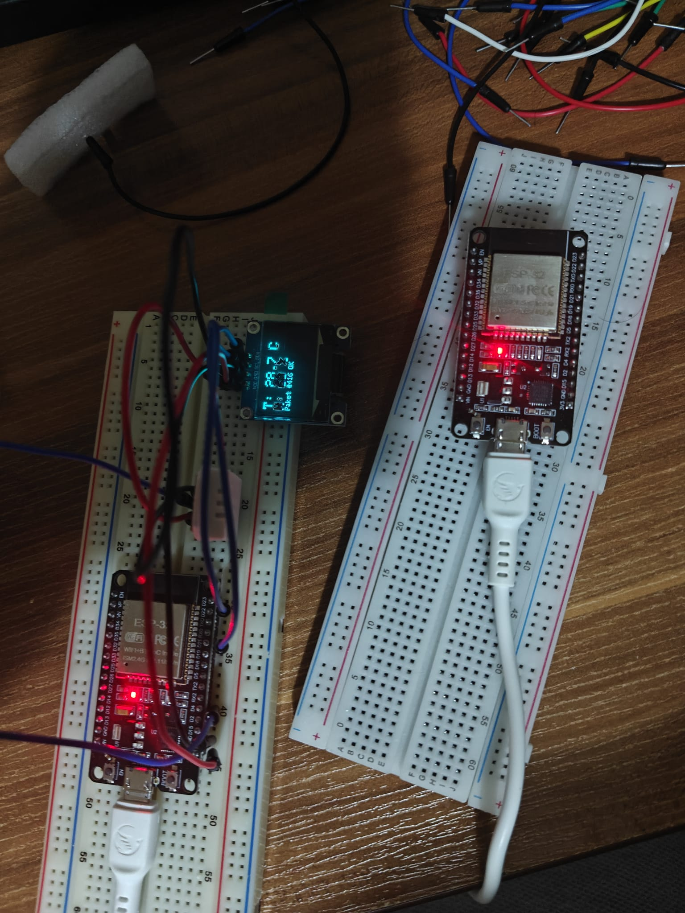

# ESP32 Encrypted Wireless Sensor Link



Two ESP32 boards exchange temperature and humidity readings over ESP-NOW. Every packet is encrypted and authenticated with AES-128-GCM, and the receiver rejects replayed or tampered packets. The receiver also reports signal strength (RSSI) and packet loss.

## What it does

- **Sender:** reads a DHT22 sensor, shows the values on an SSD1306 OLED, encrypts them and transmits every 2 seconds.
- **Receiver:** decrypts and verifies each packet, rejects invalid or replayed ones, and prints the reading, RSSI and running packet-loss statistics to the serial monitor.

```
DHT22 --> [ESP32 sender] --(ESP-NOW, AES-GCM)--> [ESP32 receiver] --> Serial Monitor
              |
            OLED
```

## Security design

| Feature | How it is done |
|---|---|
| Confidentiality | AES-128 in GCM mode (mbedTLS, built into the ESP32 Arduino core) |
| Integrity / authenticity | 16-byte GCM authentication tag; packets with a wrong tag are dropped |
| Nonce | Fresh random 12-byte nonce for every packet (`esp_fill_random`) |
| Replay protection | Monotonic packet counter inside the encrypted payload; the receiver rejects any counter that is not greater than the last accepted one |
| Counter persistence | Sender stores the counter in flash (`Preferences`) and skips ahead after a reboot, so a restart does not make valid packets look old |
| Key handling | Key lives in `secrets.h`, which is git-ignored; `secrets.example.h` shows the format |

Example receiver output:

```
[25s] #290  T=28.7C  N=58%  RSSI=-33 dBm  alinan=13  kayip=0 (%0.0)  tekrar_red=2
TEKRAR paket reddedildi (sayac 290)
```

(Log messages are in Turkish: `alinan` = received, `kayip` = lost, `tekrar_red` = replays rejected.)

## Hardware

- 2x ESP32 DevKit (30-pin, CP2102)
- DHT22 module
- SSD1306 0.96" I2C OLED (128x64)
- Breadboard and jumper wires

### Wiring (sender)

| Part | Pin | ESP32 |
|---|---|---|
| OLED | SDA | GPIO21 |
| OLED | SCL | GPIO22 |
| OLED | VCC / GND | 3V3 / GND |
| DHT22 | DATA | GPIO4 |
| DHT22 | VCC / GND | 3V3 / GND |

The receiver